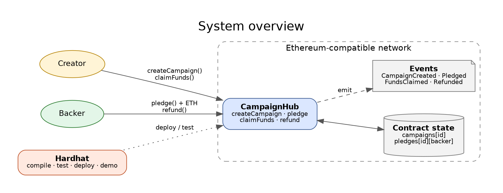
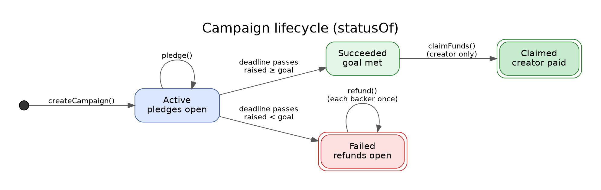
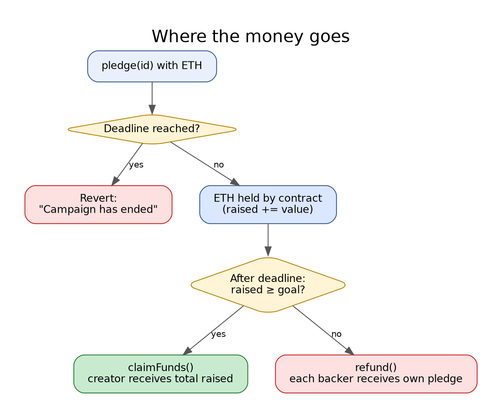

# CampaignHub

An all-or-nothing crowdfunding smart contract for Ethereum-compatible chains, built and tested with [Hardhat](https://hardhat.org)

Anyone can open a campaign with a funding goal and a deadline. Backers pledge ETH while it runs. When time is up, one of two things happens:

- **Goal reached** → the creator withdraws everything raised
- **Goal missed** → every backer withdraws their own pledge

The contract has no admin, no fees and no upgrade path. Funds can only leave through those two routes

## How it works

### System overview



### Campaign lifecycle



`statusOf(id)` derives the state from the clock and the totals, so nothing has to be "finalised" by a transaction before backers can act

### Where the money goes



## Project structure

```
.
├── contracts/
│   ├── CampaignHub.sol          # the crowdfunding contract
│   └── mocks/RefundAttacker.sol # test helper that attempts re-entrancy
├── test/CampaignHub.test.js     # unit tests
├── scripts/
│   ├── deploy.js                # deploys CampaignHub
│   └── demo.js                  # runs a success and a failure scenario locally
├── docs/
│   ├── diagrams/                # Graphviz sources (.dot) and rendered PNGs
│   └── screenshots/
├── hardhat.config.js
└── package.json
```

## Getting started

Requires Node.js 16 or newer

```bash
npm install
npm run compile
npm test
```

| Command | What it does |
| --- | --- |
| `npm test` | Run the test suite |
| `npm run test:gas` | Run the tests with a gas report |
| `npm run coverage` | Generate a coverage report |
| `npm run demo` | Play through one successful and one failed campaign |
| `npm run node` | Start a local JSON-RPC node |
| `npm run deploy:local` | Deploy to the local node |

## Contract API

| Function | Who | Description |
| --- | --- | --- |
| `createCampaign(title, goal, duration)` | anyone | Opens a campaign. `goal` is in wei, `duration` in seconds. Returns the new id. |
| `pledge(id)` | anyone | Payable. Adds `msg.value` to the campaign until its deadline. |
| `claimFunds(id)` | creator | After the deadline, if the goal was met, sends the total raised to the creator. Once only. |
| `refund(id)` | backer | After the deadline, if the goal was missed, returns the caller's pledge. Once only. |
| `getCampaign(id)` | view | Creator, title, goal, deadline, raised, claimed. |
| `pledgeOf(id, backer)` | view | Amount a backer currently has in a campaign. |
| `statusOf(id)` | view | `Active`, `Succeeded`, `Claimed` or `Failed`. |

Events: `CampaignCreated`, `Pledged`, `FundsClaimed`, `Refunded`

## Security notes

- **Checks-effects-interactions.** State is updated before ETH is sent in both `claimFunds` and `refund`
- **Re-entrancy test.** `RefundAttacker` tries to call `refund` again from its `receive` hook; the suite checks that the attempt fails and the funds stay put
- **Pull payments.** Backers withdraw their own refunds, so one failing recipient cannot block anyone else
- **Not audited.** This is a learning and reference project. Have it reviewed before it holds real value

## Configuration and deployment

Local deployment:

```bash
npm run node            # terminal 1
npm run deploy:local    # terminal 2
```

For a public network, export the settings as environment variables (never commit them):

```bash
export RPC_URL="https://your-rpc-endpoint"
export DEPLOYER_KEY="0x..."   # a funded throwaway key
npm run deploy:remote
```
